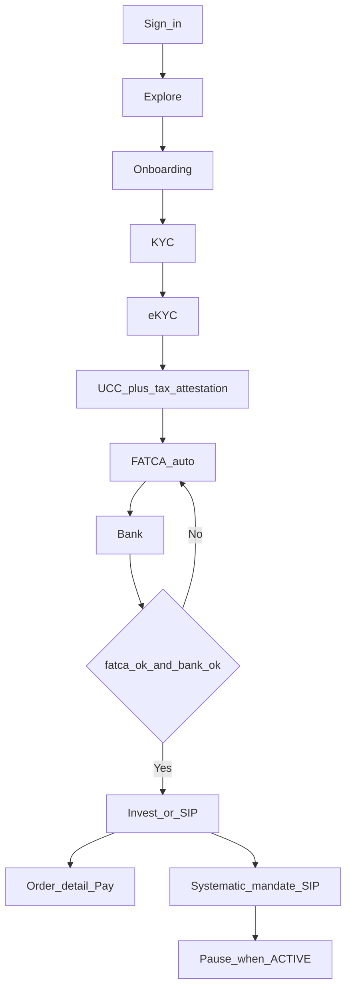

# New user — Mutual Funds journey (dig / desk UAT)

How a **new** Asrax user uses MF from first login through buy, sell, SIP pause.  
Dig BFF: `https://am-dev.asrax.in/router/am/mf` · UI: Mutual Funds module.  
Local UI (`npm run run:app:dev`): MF calls go through `scripts/dev_mf_proxy.py` (`AM_MF_PROXY_BASE` → `http://127.0.0.1:9011/router/am/mf`) to avoid browser CORS against dig api-gateway.

**Latest live run (API):** [NEW-USER-RUN-LOG-2026-11-23.md](./NEW-USER-RUN-LOG-2026-11-23.md) — user `kumargyan89@gmail.com`, UCC ok → purchase submitted → pay rejected (trust) → mandate pending → XSIP 409.

## Hard rules

1. **Asrax login ≠ NSE client.** UCC binds PAN (+ `client_code`) to your `X-User-Id` / JWT `sub`.
2. **Trading needs `fatca_ok` + `bank_ok`** on the investor profile (BFF 403 `ONBOARDING_INCOMPLETE` otherwise). Purchase, redeem, and SIP register are gated.
3. **Dig soft vs strict:** dig Helm `MF_ONBOARDING_STRICT=false` (soft KYC / eKYC Skip / optional fixture `client_code`). Preprod/prod set `true` (hard KYC, no eKYC skip, hide client_code — auto-generated).

**Dig investable schemes (desk mapper today):**

| ISIN | Role |
|------|------|
| `INF579M01AV5` | 360 ONE Balanced Hybrid — Growth (primary buy/SIP) |
| `INF579M01AW3` | Same fund — IDCW Payout peer |

---

## End-to-end map

---

## Onboarding (UI)

Route: `/app/mutual-funds/onboarding`  
Meta: `GET /v1/mf/meta` → `onboarding_strict`.

| Step | Dig soft | Strict (preprod/prod) |
|------|----------|------------------------|
| KYC | Advance even if KRA NOT AVAILABLE | Block until KYC `ok` |
| eKYC | Skip allowed | No Skip; must succeed |
| UCC + FATCA | One step: identity + tax fields + attestation → Submit UCC → **auto FATCA** | Same; client_code field hidden (BFF auto-generates) |
| Bank | Register account/IFSC; **Retry FATCA** if auto-FATCA failed | Same |

FATCA fields (resident India only this slice): `country_of_birth`, `citizenship` / tax residency, `tax_status=01`, required `dob`. Non-IN → hard stop (“NRI not supported yet”). No separate FATCA wizard step.

Attestation checkbox: confirms India tax residency and that standard resident FATCA defaults may be submitted.

### APIs

| Call | Notes |
|------|--------|
| `GET /v1/mf/kyc` | Soft dig; strict maps NOT AVAILABLE → `ok:false` |
| `POST /v1/mf/kyc/ekyc/start` | Dig often fails — Skip only when soft |
| `POST /v1/mf/onboarding/ucc` | Requires `dob`; auto `client_code` if omitted |
| `POST /v1/mf/onboarding/fatca` | Requires DOB; sets `fatca_ok` |
| `POST /v1/mf/onboarding/bank` | Sets `bank_ok` |

Pre-gate dig users (FATCA done before flags existed): open Onboarding → **Retry FATCA** + re-submit Bank once.

---

## Invest / Pay / SIP (where screens actually are)

| Expectation | Where it is |
|-------------|-------------|
| Payment | **Order detail** after Invest — `/app/mutual-funds/orders/:orderId` (“Pay on this screen”). No `/payment` route. |
| SIP create + pause | **Systematic** tab + **History → SIPs** |
| Explore “SIP” | Opens Systematic with `?isin=` |

**Dig pay:** often `DISTRIBUTOR_REJECTED` (non-trusted member) — ops checklist below.  
**Pause:** needs SIP with desk ref and mandate **ACTIVE** (eNACH). Pending mandate → empty-state explains the path.

Invest 403 with FATCA/bank message → finish Onboarding, then retry.

---

## Explore returns (1Y / 3Y)

Period chips use catalog `returnsPct` from `mf_scheme_returns`.  
Dig: table applied; CronJobs `am-mf-catalog-nav-daily` / `morning` applied with `MF_PUSH_RETURNS=1`. Populate needs published `am-mf-catalog-job` image + NAV history (3Y/5Y may stay sparse). UI shows “Period returns not available yet” when empty; **6M** chip hidden (no `ret_6m` column).

---

## Phase checklist (new dig user)

1. Sign in (Keycloak).  
2. Explore — NAV-first; dig buyable = AV5/AW3.  
3. Onboarding: KYC → eKYC Skip (soft) → UCC+attestation+tax → FATCA auto → Bank.  
4. Confirm UCC/FATCA/Bank messages ok.  
5. Invest AV5 → lands on order detail → Pay (may fail trust).  
6. Systematic: mandate → wait ACTIVE → SIP → Pause when ACTIVE.  
7. Holdings / Redeem (also need fatca_ok+bank_ok).

---

## Ops checklist (not app bugs)

- [ ] NSE **trusted member** — unblocks live pay  
- [ ] Bank **eNACH** completed — mandate ACTIVE → XSIP / pause  
- [ ] Publish **`am-mf-catalog-job`** image to GHCR — CronJob can fill returns  
- [ ] Preprod/prod Helm: `MF_ONBOARDING_STRICT=true`

---

## Out of scope (later product)

- Full NRI / multi-TIN CRS questionnaire  
- Retail auto-UCC branding beyond BFF auto `client_code`  
- Dedicated `/payment` or `/sips/:id` pages  
- Expand investable ISINs beyond mapper  
